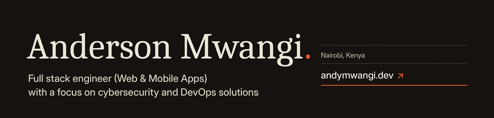

  
  
  

I build secure, scalable software across web, mobile and APIs. Open to USD contracts.

### Projects

| | |
| :-- | :-- |
| **FarmData Pod** | Offline-first agricultural data and field operations. `React Native` `Django` `TypeScript` |
| **Utulivu** | AI wellness platform with multi-layer memory. `NestJS` `PostgreSQL` |
| **Wakili360** | AI-assisted legal document automation. `NestJS` `Next.js` `React Native` `TypeScript` |

### Stack

 

<picture>
  <source media="(prefers-color-scheme: dark)" srcset="https://raw.githubusercontent.com/Andymwangi/Andymwangi/output/github-contribution-grid-snake-dark.svg" />
  <source media="(prefers-color-scheme: light)" srcset="https://raw.githubusercontent.com/Andymwangi/Andymwangi/output/github-contribution-grid-snake.svg" />
  
</picture>

---

<i>Invictus Maneo</i> &nbsp;|&nbsp; I remain unvanquished.
